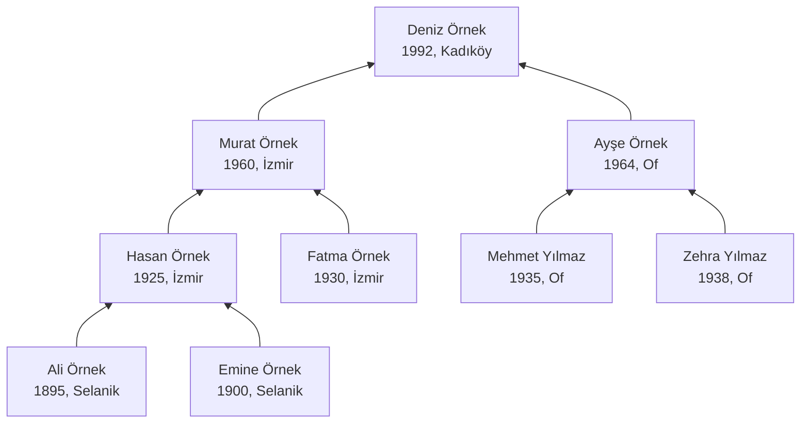
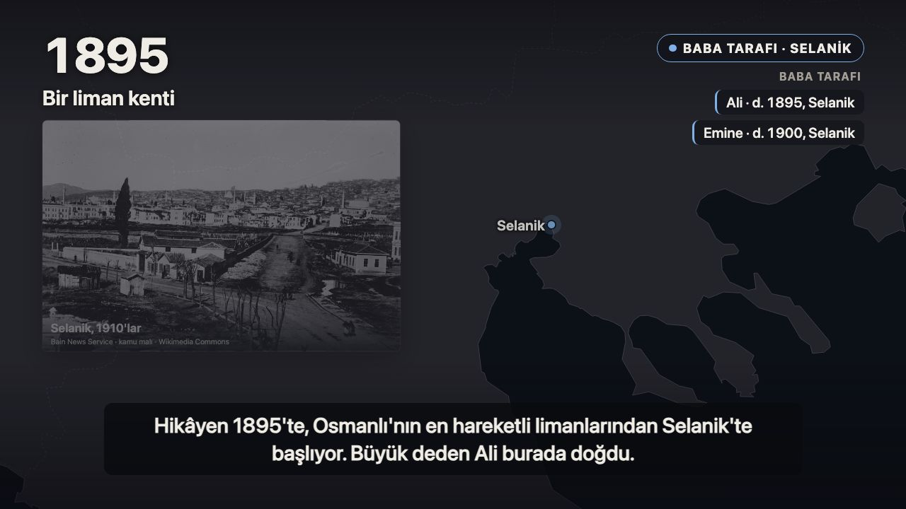

# Aile Göç Hikâyesi

**Soy ağacınızı verin; Claude atalarınızın yaşadığı her yeri kendi döneminde araştırsın, kaynaklı bir rapor yazsın ve ailenizin göçünü Türkçe seslendirmeli bir harita videosuyla anlatsın.**

> Bu depo, Fatih Kadir Akın'ın [family-migration-story](https://github.com/f/family-migration-story) projesinden türetilmiş, geliştirilmiş bir sürümdür. Yenilikler aşağıda, [Bu sürümde neler var?](#bu-sürümde-neler-var) bölümünde.

`family-migration-story`, [Claude Code](https://code.claude.com) için bir skill ve plugin'dir. Girdi olarak e-Devlet "Alt-Üst Soy Bilgisi" PDF'ini, MyHeritage / Ancestry / FamilySearch'ten alınmış bir GEDCOM dosyasını ya da elle yazılmış bir listeyi kabul eder.


<sub>Yukarıdaki görüntüler aşağıdaki uydurma "Örnek ailesi"nden alındı. Kişiler kurgusaldır; yerler, tarihler ve kaynaklar gerçektir.</sub>

## Ne üretir?

1. **Araştırma dosyası** (`research/dossier.json`): Ailenin yaşadığı her yer, ailenin orada bulunduğu yıllar için araştırılır. Kaynaklar arasında Osmanlı arşiv kataloğu, salnameler, nüfus sayımları, Wikidata, akademik makaleler (OpenAlex, Crossref, DergiPark) ve dijitalleştirilmiş kitaplar (Internet Archive, HathiTrust) var. Her bulgu kaynağıyla ve bir güven derecesiyle yazılır.
2. **HTML rapor** (`report.html`), şunları içerir:
   - köken dağılımı
   - kuşak kuşak kişiler
   - her yerin o zamanı ve bugünü
   - aile olaylarıyla dünya olaylarını birleştiren zaman çizelgesi
   - açık sorular
   - kaynakça
3. **Harita videosu** (`video/out/*.mp4`), [Remotion](https://www.remotion.dev) ile hazırlanır:
   - Anne ve baba tarafları ayrı ayrı değil, tek bir zaman çizgisinde iç içe anlatılır.
   - Göç yolları haritada çizilir ve dönem fotoğrafları gösterilir.
   - Savaşlar, antlaşmalar, mübadele ve Soyadı Kanunu gibi dünya ve Türkiye olayları hikâyeye katılır.
   - Seslendirme bilgisayarınızda yapılır; Türkçe için [yazgi-tts](https://huggingface.co/erkamk/yazgi-tts-1) kullanılır.

## Bu sürümde neler var?

| Yenilik | Ne yapar |
|---|---|
| **Windows desteği** | Bütün betikler artık Python ve Node ile yazıldı; Windows, macOS ve Linux'ta aynı komutlarla çalışır. ffmpeg kurmak zorunlu değil: sistemde yoksa Remotion'ın kendi ffmpeg'i kullanılır. Windows'un kendi sesleri (`--engine sapi`) ve Türkçe karakterler için UTF-8 konsol çıktısı eklendi. |
| **Dönemin sınırları** | Harita artık bugünün sınırlarını değil, her sahnenin kendi tarihindeki devlet sınırlarını gösterir: 1895'te Selanik Osmanlı'da, 1923'te Yunanistan'da. Veri [CShapes 2.0](https://icr.ethz.ch/data/cshapes/) (1886-2019, her sınır değişikliği tarihli). Devlet adları haritaya Türkçe yazılır, sahne değişince sınırlar yumuşakça geçer. |
| **Etkileşimli harita** | Raporun içinde yıl kaydırıcılı bir harita: ▶ ile oynatınca aile yıl yıl yerlere yayılır, göç yolları çizilir, sınırlar değişir. Bir yere tıklayınca o yerin tarihi, orada doğan aile üyeleri ve kaynaklı bulgular açılır. İnternete bağlanmadan çalışır, hiçbir yere veri göndermez. |
| **Aile fotoğrafları ve belgeler** | Kendi eski fotoğraflarınızı, nüfus kayıtlarınızı, mektuplarınızı bir listeyle (`family-media.tsv`) videoya ve rapora ekleyebilirsiniz. Belgeler kırpılmadan bütün olarak gösterilir; künyede "Aile arşivi" olarak geçer. |
| **Dikey video** | Instagram Reels, TikTok, YouTube Shorts ve WhatsApp durumu için 1080×1920 sürüm. Başlık ve bilgiler üstte, altyazı uygulamaların düğmelerine denk gelmeyecek yerde; uzun cümleler parça parça gösterilir. |
| **Başka dilde video ve altyazı** | Yurt dışındaki akrabalar için aynı videonun başka dilde sürümü: ya kendi seslendirmesiyle ya da Türkçe ses + çeviri altyazıyla. Her dil için ayrı `.srt` altyazı dosyası. |
| **Taslak seslendirme** | `--engine draft` ile hiçbir ses modeli kurmadan, sessiz ve tahminî zamanlı bir taslak üretip görüntüleri önceden kontrol edebilirsiniz. |

## Önerilen model: Claude Opus 5.5, effort `xhigh`

Bu skill uzun ve çok adımlı bir iş yapar: onlarca kaynak okur, yüzlerce araç çağrısı yapar, bulguları derecelendirir, sonra hikâyeyi ve videoyu kurup kontrol eder. En iyi sonucu **Claude Opus 5.5** ve **xhigh** effort ile verir. Daha küçük bir model ya da daha düşük effort daha az kaynak okur ve daha yüzeysel bir araştırma çıkarır.

Claude Code'u bu ayarlarla başlatın:

```bash
claude --model claude-opus-5-5 --effort xhigh
```

Açık bir oturumda aynı ayarı `/model claude-opus-5-5` ve ardından `/effort xhigh` ile yapabilirsiniz. Opus 5.5 güncel bir Claude Code ister; gerekirse önce `claude update` çalıştırın.

Skill'in kendi ayarlarında da `model: claude-opus-5-5` ve `effort: xhigh` var. Bu yüzden `/family-migration-story` diye çağırdığınızda Claude Code o tur için bu modeli ve effort'u kullanır. Hesabınızda bu model açık değilse oturumunuzdaki modelle devam eder; o durumda elinizdeki en güçlü modeli ve en yüksek effort'u seçin.

## Kurulum

Terminalde iki komut:

```bash
claude plugin marketplace add f/family-migration-story
```

```bash
claude plugin install family-migration-story@family-migration-story
```

Ya da açık bir Claude Code oturumunda:

```text
/plugin marketplace add f/family-migration-story
/plugin install family-migration-story@family-migration-story
```

Kurulumdan sonra Claude Code'u yeniden başlatın ya da oturumda `/reload-plugins` yazın.

Güncellemek ve kaldırmak için:

```bash
claude plugin update family-migration-story@family-migration-story
```

```bash
claude plugin uninstall family-migration-story@family-migration-story
```

**Bu geliştirilmiş sürümü kurmak için** (bilgisayarınızdaki klasörden):

```bash
claude plugin marketplace add C:\Users\<kullanıcı>\Desktop\AileGocHikayesi
```

```bash
claude plugin install family-migration-story@family-migration-story
```

Ya da yalnızca skill klasörünü Claude Code'un skill klasörüne kopyalayın (Windows PowerShell):

```powershell
Copy-Item -Recurse skills\family-migration-story "$env:USERPROFILE\.claude\skills\"
```

Plugin sistemi yerine orijinal projenin yalnızca skill klasörünü kullanmak isterseniz:

```bash
git clone https://github.com/f/family-migration-story.git && cp -R family-migration-story/skills/family-migration-story ~/.claude/skills/
```

### Gereksinimler

| Ne için | Gereken |
|---|---|
| Her şey | Güncel Claude Code, web araması açık |
| e-Devlet PDF'i okumak | [uv](https://docs.astral.sh/uv/) (pypdf'i geçici olarak kurar) |
| Araştırma ve rapor | Python 3.10+ (yalnızca standart kütüphane) |
| Video | Node.js 20+, uv ve yaklaşık 5 GB boş disk (ffmpeg isteğe bağlı) |

Video için gereken modeller ilk kullanımda bir kez indirilir:
- yazgi-tts modeli (~1,2 GB)
- doğrulama için faster-whisper (~0,5 GB)
- Remotion'ın kullandığı tarayıcı
- dönem sınırları için CShapes 2.0 (~26 MB)

Skill macOS'ta geliştirildi; bu sürüm Windows 11'de de denendi. Türkçe dışındaki dillerde işletim sisteminin kendi sesleri kullanılır (macOS `say`, Windows'ta `sapi`; Windows'a yeni dil sesleri Ayarlar > Saat ve dil > Konuşma'dan eklenir).

## Kullanım

Soy ağacınızı Claude Code'a verin ve ne istediğinizi yazın:

- "Ekteki e-Devlet soy ağacımı araştır; kaynaklı bir rapor ve Türkçe seslendirmeli bir harita videosu hazırla."
- "MyHeritage'tan aldığım `family.ged` dosyasındaki ailemin nereden geldiğini araştır, kaynaklı rapor yaz. Video şimdilik gerekmiyor."
- "Anneannemin ailesi 1924'te Kavala'dan gelmiş, babamın tarafı Rize'den. Elimde bu isimler ve doğum yılları var, bir göç videosu yapalım."

Skill'i doğrudan çağırmak için `/family-migration-story` yazabilirsiniz.

**e-Devlet PDF'i nasıl alınır?**
1. turkiye.gov.tr'de "Alt-Üst Soy Bilgisi Sorgulama" hizmetini açın.
2. Belgeyi oluşturup PDF olarak indirin.
3. PDF'i sohbete sürükleyin.

### Aşamalar

Her aşama bir sonraki aşamanın okuduğu dosyaları bırakır. İş herhangi bir aşamada durup sonra kaldığı yerden devam edebilir.

| Aşama | Ne olur | Çıktı |
|---|---|---|
| 0. Kayıt | Soy ağacı tek bir biçime çevrilir ve doğrulanır. Ailede anlatılan hikâyeler (bir vapur, bir sandık, neden göçüldüğü) sorulur. | `familytree.json` |
| 1. Araştırma | Her yer, ailenin orada yaşadığı yıllar için araştırılır. Bulgular kaynaklı ve dereceli olarak yazılır. Dünya olayları ve "aynanın öbür yüzü" (örneğin mübadelede o köyden kimin gittiği) de eklenir. | `research/dossier.json` |
| 2. Rapor | Bulgular okunur bir rapora dönüşür. Size gösterilir; eksik ya da yanlış bir şey var mı diye sorulur. | `report.html` |
| 3. Hikâye | Sahneler yazılır: tek zaman çizgisi, kollar arasında "o sırada…" geçişleri, bölüm kartları. Seslendirmeden önce taslak size gösterilir. | `video/src/data/story.json` |
| 4. Video | Seslendirme yerelde yapılır ve her cümle yerel konuşma tanımayla kontrol edilir. Ardından video render edilir; ses düzeyi ve yazı titremesi kontrol edilir. | 1080p ve 720p `.mp4`; istenirse dikey ve başka dilde sürümler, `.srt` |

### Güven dereceleri

Her bulgu bir derece taşır. Anlatımdaki ifade de bu dereceye göre seçilir:

| Derece | Anlamı | Videoda nasıl söylenir |
|---|---|---|
| belgeli | Birincil ya da güvenilir ikincil kaynakta açıkça geçiyor | Düz cümleyle |
| olası | Kaynaklar güçlü biçimde işaret ediyor | "büyük olasılıkla", "kayıtlar … gösteriyor" |
| aile anlatısı | Ailede ya da köyde anlatılıyor, belgelenmedi | "ailede anlatılana göre" |
| tahmin | Makul ama kanıtsız | "belki de", "… olabilir" |

## Örnek: Örnek ailesi (uydurma)

Bu aile tamamen uydurmadır ve skill'in içinde [`assets/example/`](skills/family-migration-story/assets/example) klasöründe durur. Yerler, tarihler ve kaynaklar gerçektir.



Bilinenler bu kadar: doğum yerleri, yıllar ve ailede anlatılan tek bir cümle:

> "1924'te tek bir sandıkla bir vapura binip İzmir'e gelmişler."

Deniz şunu yazıyor:

> Bu soy ağacından Türkçe seslendirmeli bir göç videosu ve kaynaklı bir rapor hazırla. Anne ve baba tarafını tarih sırasıyla karışık anlat.

**Araştırmanın bulduğu** (her biri raporda kaynağıyla):
- **Selanik:** Yüzyıl başında Selanik'in en kalabalık topluluğu Yahudilerdi; şehirde Müslümanlar, Rumlar ve Bulgarlar da yaşıyordu. *(belgeli)*
- **Balkan Savaşı:** Yunan ordusu 8 Kasım 1912'de şehre girdi. Ali o sırada 17 yaşındaydı ve doğduğu şehir artık başka bir devletindi. *(belgeli)*
- **Büyük yangın:** 18 Ağustos 1917'deki yangın şehrin tarihî merkezinin büyük bölümünü yaktı. *(belgeli)*
- **Mübadele:** 30 Ocak 1923'te Lozan'da imzalanan sözleşmeyle Yunanistan'daki Müslümanlar ile Türkiye'deki Rumlar yer değiştirdi. *(belgeli)*
- **Vapur ve sandık:** Ailenin vapur ve sandık hikâyesi aile anlatısı olarak kalıyor. Videoda da öyle söyleniyor: "Ailede anlatılana göre…" *(aile anlatısı)*
- **Soyadı:** 1934'teki Soyadı Kanunu'yla aile "Örnek" soyadını alıyor. *(belgeli)*

**Rapor:**


**Video** (8 sahne, 18 cümle, 2 dakika 15 saniye). [Videonun tamamını sesiyle izleyin (720p, 5,2 MB)](https://github.com/f/family-migration-story/releases/download/v1.0.0/ornek-aile-720p.mp4).

| | |
|---|---|
|  |  |
| **1895 · Bir liman kenti.** Hikâye Selanik'te başlar; dönem fotoğrafı ve aile bilgileri ekrana gelir. | **1923-1924 · Bir vapur, bir sandık.** Lozan'daki sözleşme ve ailenin İzmir'e uzanan, temsilî olarak çizilmiş yolu. |
|  |  |
| **1935 · O sırada Karadeniz'de.** Anlatım öbür kola geçer: annenin babası Mehmet Of'ta doğar. | **1895-bugün · Bir harita, bir aile.** Bütün yollar ve köken dağılımı bir arada. |

Örneği kendi bilgisayarınızda üretmek kurulumu da sınar; birkaç dakika sürer:

macOS / Linux:

```bash
SKILL=~/.claude/skills/family-migration-story   # plugin kurduysanız: Claude'a skill klasörünün yolunu sorun
python3 -I $SKILL/scripts/new_project.py /tmp/ornek/video && cd /tmp/ornek/video
cp $SKILL/assets/example/video-data/*.json src/data/
python3 -I $SKILL/scripts/research/commons_fetch.py $SKILL/assets/example/images.tsv public/img src/data/credits.json
python3 -I $SKILL/scripts/setup_tts.py
npm run geo && npm run vo -- --engine yazgi && npm run check && npm run render
```

Windows (PowerShell):

```powershell
$SKILL = "$env:USERPROFILE\.claude\skills\family-migration-story"
python -I $SKILL\scripts\new_project.py $env:TEMP\ornek\video; cd $env:TEMP\ornek\video
Copy-Item $SKILL\assets\example\video-data\*.json src\data\
python -I $SKILL\scripts\research\commons_fetch.py $SKILL\assets\example\images.tsv public\img src\data\credits.json
npm run geo; npm run vo -- --engine draft; npm run check; npm run render; npm run render:vertical
```

`--engine draft` sessiz bir taslak üretir; Türkçe sesi kurduktan sonra (`python -I $SKILL\scripts\setup_tts.py`) `npm run vo -- --engine yazgi --all` ile gerçek seslendirmeyi yapın.

## Gizlilik

Soy ağaçları yaşayan insanların adlarını, doğum tarihlerini ve yerlerini içerir. Skill bunları şöyle korur:

- **Aramalarda isim kullanılmaz.** Web aramaları, arşiv ve makale API'leri ile görsel aramaları yalnızca yer, yıl ve konu içerir.
- **Ses yerelde üretilir ve yerelde kontrol edilir.** Seslendirme (yazgi-tts, macOS `say`, Windows sesleri) ve konuşma tanıma (faster-whisper) bilgisayarınızda çalışır; anlatım bir bulut ses servisine gönderilmez.
- **Aile fotoğrafları ve belgeleri bilgisayarınızda kalır.** Hiçbir aramaya ya da servise gönderilmez; yalnızca sizin videonuza ve raporunuza girer.
- **Etkileşimli harita çevrimdışı çalışır.** Harita ve veriler raporun içine gömülüdür; rapor açılırken internetten hiçbir şey yüklenmez.
- **Çıktılar yerel kalır.** Rapor ve video bilgisayarınızda dosya olarak durur; siz istemedikçe hiçbir yere yüklenmez.
- **İsimle kayıt araması sizin onayınızla yapılır.** Yolcu listeleri, arşiv isim dizinleri ve FamilySearch gibi aramalar yalnızca açıkça izin verirseniz yapılır.

Soy ağacınız, Claude ile yaptığınız konuşmanın bir parçası olarak işlenir. Yukarıdaki kurallar, verinin bu konuşmanın dışına (arama motorlarına, arşivlere, ses servislerine) çıkmamasını sağlar.

## Klasör yapısı

```text
.claude-plugin/          plugin ve marketplace tanımı
skills/family-migration-story/
  SKILL.md               iş akışı (Claude'un okuduğu talimatlar)
  references/            araştırma rehberi, bölgelere göre arşivler, hikâye ve video rehberi, veri biçimleri
  scripts/               e-Devlet ve GEDCOM içe aktarma, soy ağacı araçları, araştırma araçları, rapor, ses kontrolü, teslim
  assets/template/       Remotion video projesi şablonu
  assets/example/        uydurma Örnek ailesi
evals/                   `claude plugin eval` ile çalışan iki test senaryosu
docs/                    bu sayfadaki görseller
```

## Sınırlar

- Bu bir araştırma yardımcısıdır, resmî bir soy kaydı değildir. Önemli bulguları raporda verilen kaynaklardan kendiniz kontrol edin.
- Bazı arşivler (Library of Congress, Gallica, Devlet Arşivleri kataloğu) otomatik erişime kapalıdır. Skill bu arşivler için tarayıcıda açabileceğiniz bağlantılar verir.
- Dönem sınırları yaklaşıktır: CShapes 1886'dan başlar, kıyıları sadeleştirir, kısa süreli işgalleri ve küçük adaları her zaman göstermez. `npm run geo` her sahne için ailenin yerlerinin hangi devlette kaldığını yazar; bunu raporla karşılaştırın. Noktalı yollar temsilîdir; ailenin gerçek yolu belgelenmediyse anlatımda da böyle söylenir.

## Katkı

Hata bildirimlerine ve pull request'lere açığım. Özellikle şu konulardaki katkılar işe yarar:
- başka bölgeler için arşiv kaynakları (`references/archives-by-region.md`)
- farklı e-Devlet PDF düzenleri
- başka diller için yerel sesler

Katkıda bulunurken gerçek aile verisi eklemeyin; örnekler uydurma olmalı.

## Lisans

Kod [MIT](LICENSE) lisanslıdır. Kullanılan üçüncü taraf bileşenlerin kendi lisansları vardır:

- **Remotion** kendi lisansıyla dağıtılır. Bireyler ve küçük ekipler için ücretsizdir; daha büyük şirketlerin şirket lisansı alması gerekir ([remotion.dev/license](https://www.remotion.dev/license)).
- **yazgi-tts-1** Apache-2.0, **faster-whisper** MIT lisanslıdır. **Natural Earth** harita verisi kamu malıdır.
- **CShapes 2.0** (Schvitz, Rüegger, Girardin, Cederman, Weidmann, Gleditsch 2022, *Journal of Conflict Resolution* 66(1)) [CC BY-NC-SA 4.0](https://creativecommons.org/licenses/by-nc-sa/4.0/) lisanslıdır: aile videoları gibi ticari olmayan kullanım için serbesttir, kaynak gösterilmelidir (şablon bunu künyeye yazar). Ticari bir işte kullanacaksanız `meta.json`'da `"eras": false` ile kapatın. Veri depoya konmaz, ilk kullanımda indirilir.
- **Wikimedia Commons görselleri** kendi lisanslarıyla kullanılır. Her video, görsellerin yazarını ve lisansını ekranda ve kapanış künyesinde gösterir. Bu sayfadaki örnek karelerdeki fotoğraflar kamu malıdır:
  - Selanik: Bain News Service
  - Trabzon: Dmitri Ermakov
